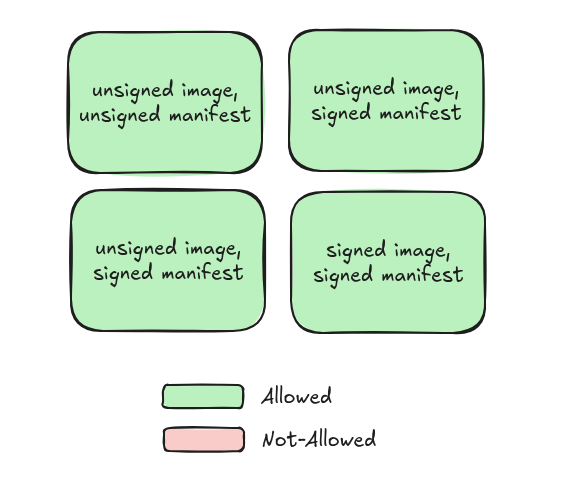

# 03 - Creating a manifest for our Simple App

In this section, we will [generate Kubernetes Deployment manifests](./01-create-manifest.sh) for our simple application. Because we want to demonstrate admission control for both Kubernetes manifests and container images, we will create two Deployment manifests: one referencing the signed container image, and another referencing the unsigned container image.

Just as we did with the application image, we will [package each manifest as an OCI artifact](./02-create-and-push-oci-artifact.sh) and push both [signed and unsigned versions](./03-sign-kube-manifest.sh). This produces a total of four OCI artifacts:
- Signed manifest referencing the signed application image
- Unsigned manifest referencing the signed application image
- Signed manifest referencing the unsigned application image
- Unsigned manifest referencing the unsigned application image

If you were to deploy them to your cluster right now (before applying any verification policies), all four OCI artifacts would be admitted:



```sh
bash ./01-create-manifest.sh
bash ./02-create-and-push-oci-artifact.sh
bash ./03-sign-kube-manifest.sh
```
