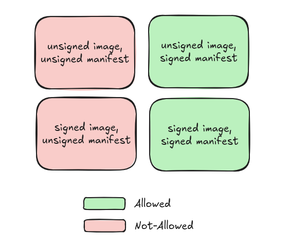

# 04 - Validating manifest signatures

In this section, we will demonstrate how to leverage Flux CD and Kyverno to verify the signatures of the OCI artifacts we intend to deploy. Both approaches achieve the same goal through different mechanisms.

Once the controls in this section are applied, signed OCI manifest artifacts will be allowed while unsigned OCI manifest artifacts will be rejected. However, this section does not yet validate the signature of the underlying container image referenced inside the manifest. This means that an unsigned application image packaged inside a signed OCI manifest artifact can still be deployed. At the end of this section, our controls will look as follows:



> [!WARNING]
>
> Do not delete the Kyverno policies after finishing this section. We will build upon them as a stepping stone in the next section.

## Flux CD

Flux CD provides a custom resource called `OCIRepository`. Its `.spec.verify` block allows specifying a public key to verify the cryptographic signature of the target OCI artifact. In [our example](./flux-ocirepo.yaml), it references the Kubernetes Secret containing the public key we created in [the first section](../01-openbao-transit-engine/). Flux CD automatically validates the signature before reconciling the artifact, rejecting any unsigned OCI artifacts.

```sh
bash ./01-deploy.sh
bash ./02-cleanup.sh
```

> [!TIP]
>
> The `.spec.verify` field in an `OCIRepository` resource is optional. To strictly enforce Flux-level signature validation across a cluster, you would need an admission policy that requires `.spec.verify` to be present on all `OCIRepository` resources.

## Kyverno

Kyverno can also verify the signature of the `OCIRepository` artifact at admission time using an `ImageValidatingPolicy` resource. The key parts of our example [policy](./kyverno-verify-oci-artifact-signature.yaml) are:

- `.spec.matchImageReferences`: selects which OCI artifact references to intercept within `OCIRepository` resources.
- `.spec.attestors`: configures the policy to use Cosign and our OpenBao key for signature verification.
- `.spec.validations`: defines the CEL validation rules. In our case, we reject malformed `OCIRepository` resources without artifacts and verify that the referenced OCI artifact is signed with our OpenBao key.

```sh
bash ./03-kyverno-policies.sh         # Apply Kyverno policies first this time
bash ./01-deploy.sh
bash ./02-cleanup.sh
```

> [!TIP]
>
> Notice that this time, the rejection error for unsigned OCI artifacts comes directly from Kyverno during admission control (`kubectl apply`), even though we are applying the exact same resources as before. Whereas Kyverno blocks the `OCIRepository` resource from ever entering etcd, Flux CD performs its verification asynchronously during the reconciliation loop after admission control has already accepted the resource.

## References

- [Flux CD Docs - Source Controllers - OCI Repositories](https://fluxcd.io/flux/components/source/ocirepositories/#verification)
- [Kyverno Docs - Policy Types - ImageValidatingPolicy](https://kyverno.io/docs/policy-types/image-validating-policy/)
