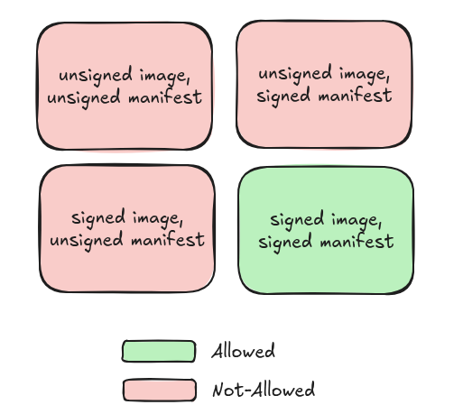

# 05 - Image signature verification

In the previous section, we validated the signature of the OCI artifact containing our Kubernetes deployment manifest using both Flux CD and Kyverno. However, that step only verified the manifest package itself—it did not verify the signature of the application container image referenced inside the Deployment. Because Flux CD does not natively verify container image signatures inside manifests, we will rely on Kyverno to close this gap.

The [Kyverno policy](./image-signature-verification.yaml) in this section differs slightly from the previous one:

- `.spec.matchConstraints`: targets `Pod` resources instead of `OCIRepository` resources.
- `.spec.matchImageReferences`: matches the application container image in the OCI registry rather than the manifest artifact.
- `.spec.validations`: uses the `verifyImageSignatures` CEL function built into `ImageValidatingPolicy`.

We will reuse the [deployment script](./02-deploy.sh) from the previous section to test our layered Kyverno policies. Assuming the policy from Section 04 is still active, only the signed OCI manifest artifact referencing the signed application container image will be admitted:



Run this section with the following commands:

```sh
bash ./01-deploy-kyverno-policy.sh
bash ./02-deploy.sh
```

## References

- [Kyverno Docs - Policy Types - ImageValidatingPolicy](https://kyverno.io/docs/policy-types/image-validating-policy/)
- [Kyverno Docs - Policy Types - ImageValidatingPolicy - CEL libraries](https://kyverno.io/docs/policy-types/image-validating-policy/#cel-libraries)
