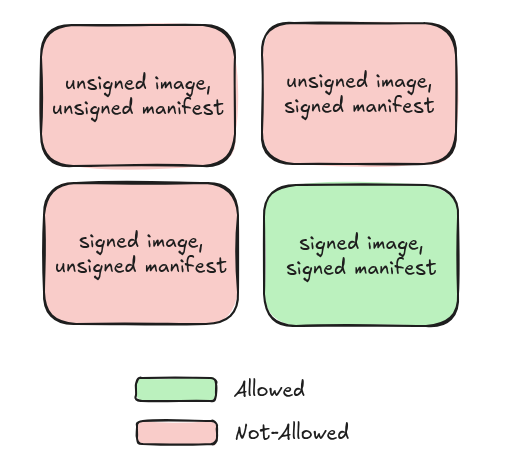

# 05 - Image signature verification

In the previous section, we verified the signature of our Kubernetes manifest OCI artifact with Flux CD and Kyverno.
That step verified the manifest package itself, not the application container image referenced inside the Deployment.
Because Flux CD does not verify container image signatures inside manifests, we will use Kyverno to close this gap.

The [Kyverno policy](./image-signature-verification.yaml) in this section differs slightly from the previous one:

- `.spec.matchConstraints`: targets `Pod` resources in `apps` (`namespaceSelector`). Kyverno automatically generates rules for controllers like `Deployment`s.
- `.spec.matchImageReferences`: matches every container image (`glob: "*"`) deployed into `apps`.
- `.spec.variables` & `.spec.validations`: combines `containers` and `initContainers` into `variables.allImages` for `verifyImageSignatures`.

We will reuse the [deployment script](./02-deploy.sh) from the previous section to test our layered Kyverno policies.
With the Section 04 policy still active, only the signed manifest referencing the signed container image will be admitted:



Run this section with the following commands:

```sh
bash ./01-deploy-kyverno-policy.sh
bash ./02-deploy.sh
flux get kustomizations -n apps --watch  # Press Ctrl+C once reconciled
```

You can also inspect the reconciliation status in the **Flux UI** tab.
The two unsigned manifests are rejected immediately during `kubectl apply`.
Meanwhile, `unsigned-image-signed-manifest` fails `Kustomization` reconciliation when Kyverno blocks its unsigned image.
Only `signed-image-signed-manifest` becomes `Ready`.

## References

- [Kyverno Docs - Policy Types - ImageValidatingPolicy](https://kyverno.io/docs/policy-types/image-validating-policy/)
- [Kyverno Docs - Policy Types - ImageValidatingPolicy - CEL libraries](https://kyverno.io/docs/policy-types/image-validating-policy/#cel-libraries)
